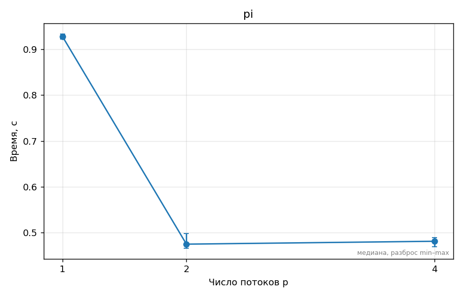
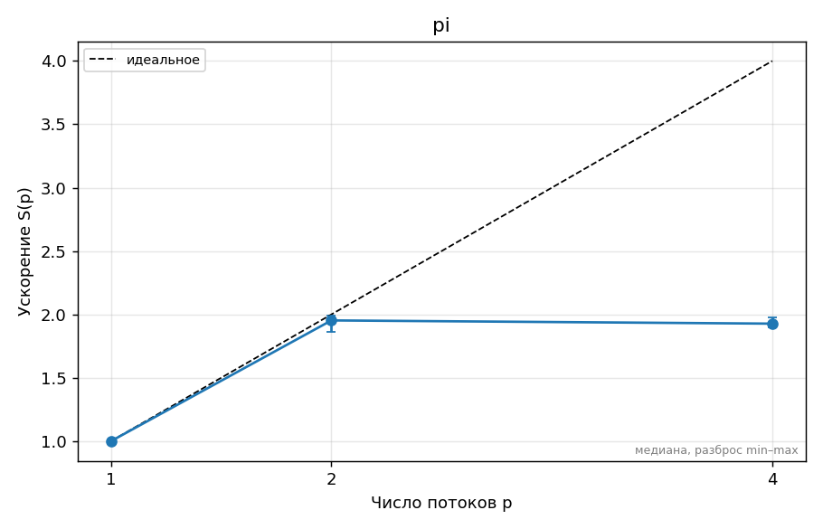
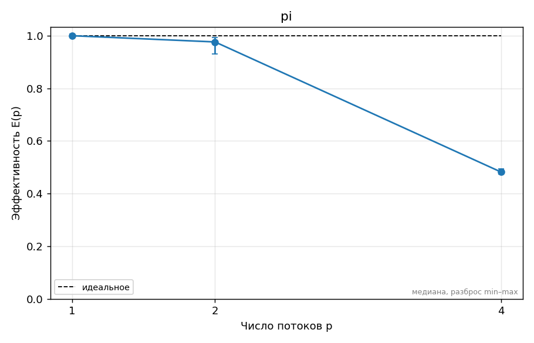

# ДЗ 0. Название задания — Алексеева Алёна, вариант 1

## 1. Прогноз

Я использую процессор Intel Celeron 6305 с двумя физическими ядрами и двумя логическими процессорами.
Ожидаемое ускорение:
- 1 поток: 1х (базовый результат).
- 2 потока: примерно 2х, поскольку два потока могут выполняться одновременно на двух физических ядрах.
- 4 потока: примерно 1,5х, поскольку число потоков превышает количество физических ядер и возникают дополнительные накладные расходы.
При дальнейшем увеличении числа потоков производительность может снизиться из-за конкуренции за вычислительные ресурсы.

## 2. Стенд

Я работала на ноутбуке с процессором Intel Celeron 6305, имеющим 2 физических ядра и 2 логических процессора. Оперативная память — 7,8 ГБ.
Операционная система: Ubuntu 26.04.1 LTS под WSL2 в Windows. Компилятор GCC 15.2.0, OpenMP 4.5 (`_OPENMP=201511`).
Подробные характеристики представлены в [SYSTEM.md](../SYSTEM.md).
Процессор не имеет отдельных P- и E-ядер. Измерения проводились в виртуализированной среде WSL2.

## 3. Методика

Для исследования использовалась готовая программа вычисления числа π (`hw0/src/pi.c`).
Эксперимент запускался командой: make bench THREADS=1,2,4
Параметры: N = 400000000, количество потоков — 1, 2 и 4. Для каждого количества потоков выполнено пять измерений.
В качестве итогового времени использовалась медиана пяти измерений. Ускорение вычислялось как отношение времени на одном потоке ко времени на выбранном количестве потоков. Эффективность — как ускорение, делённое на количество потоков.
Корректность программы предварительно проверена командой make test. Для всех конфигураций получено значение π ≈ 3,141592653590.

## 4. Результаты

| Потоки | Время (с) | Ускорение | Эффективность |
|--------|-----------|-----------|---------------|
| 1      | 0.9283    | 1.00      | 100%          |
| 2      | 0.4751    | 1.95      | 97.7%         |
| 4      | 0.4814    | 1.93      | 48.2%         |

Время выполнения

Время выполнения значительно сократилось при переходе с одного потока на два. При четырёх потоках заметного дополнительного ускорения не произошло.

Ускорение

Максимальное медианное ускорение достигнуто при двух потоках и составляет примерно 1,95 раза.

Эффективность

На двух потоках эффективность составляет около 97,7%, а на четырёх снижается примерно до 48,2%, поскольку количество потоков превышает число доступных логических процессоров.

## 5. Объяснение расхождений с прогнозом

1 поток. Ускорение составляет 1,00, поскольку эта конфигурация выбрана базовой. Прогноз подтвердился по определению.

2 потока. Прогнозировалось ускорение около 2,00 раза, фактически получено 1,95 раза. Результаты близки к прогнозу. Два потока могут выполняться одновременно на двух физических ядрах. Небольшое отклонение от идеального ускорения может объясняться накладными расходами и особенностями выполнения программы.

4 потока. Прогнозировалось ускорение около 1,50 раза, но фактически получено около 1,93 раза. Результат оказался лучше прогноза. Несмотря на использование четырёх потоков, у процессора только два физических ядра. Дополнительные потоки не дали прироста относительно двух потоков, но и не вызвали предполагавшегося существенного падения производительности. Возможные причины — небольшие накладные расходы в данной задаче и особенности планирования потоков.

## 6. Выводы

1. Настроена среда для параллельного программирования OpenMP в Ubuntu через WSL2.
2. Проверена работа GCC и предложенных программ.
3. На двух потоках получено ускорение примерно в 1,95 раза.
4. Увеличение количества потоков до четырёх не улучшило производительность.
5. Для рассматриваемой задачи оптимальным из проверенных вариантов оказалось использование двух потоков.
